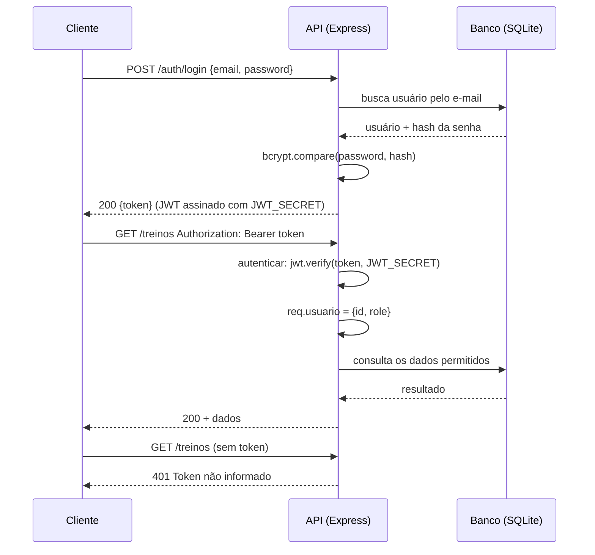

# API Academia — Projeto API Segura

**Grupo:** Matheus Andreato, Kevyn Freitas · 3º AI · ETECAMP

## 1. Sobre o projeto

API REST para uma academia. Alunos (perfil `USER`) cadastram-se, fazem login e consultam e gerenciam apenas os **seus** treinos. Instrutores (perfil `ADMIN`) enxergam e alteram o treino de qualquer aluno e gerenciam os perfis dos usuários. O recurso principal é o **Treino**, que pertence a um aluno (relação 1:N: um `User` tem vários `Treino`).

Tecnologias: Node.js, Express 5, Prisma ORM 7, SQLite, jsonwebtoken e bcryptjs.

## 2. Como rodar

```bash
npm install
cp .env.example .env        # Windows: copy .env.example .env
npx prisma migrate dev
npx prisma generate
npx prisma db seed
npm run dev
```

Edite o `.env` e troque o `JWT_SECRET` por uma frase longa e aleatória. A API sobe em `http://localhost:3000`.

Usuários de teste (senha: `123456`):

| E-mail | Perfil |
|---|---|
| admin@academia.com | ADMIN |
| ana@academia.com | USER |
| bruno@academia.com | USER |

Para repopular o banco do zero: `npx prisma migrate reset --force`, depois `npx prisma generate` e `npx prisma db seed`.

## 3. Mapa de rotas

| Método | Rota | Acesso | Proteção |
|---|---|---|---|
| GET | / | Pública | — |
| POST | /auth/register | Pública | Validação de campos; senha ≥ 6; hash bcrypt; nasce `USER` |
| POST | /auth/login | Pública | Mensagem de erro genérica; devolve JWT |
| GET | /auth/me | Logado | `autenticar` |
| GET | /treinos | Logado | `autenticar`; USER vê os seus, ADMIN vê todos |
| POST | /treinos | Logado | `autenticar`; dono = `req.usuario.id` (vem do token) |
| PUT | /treinos/:id | Dono ou ADMIN | `autenticar` + regra do dono (404 antes de 403) |
| DELETE | /treinos/:id | Dono ou ADMIN | `autenticar` + regra do dono (404 antes de 403) |
| GET | /users | ADMIN | `autenticar` + `autorizar('ADMIN')` |
| PATCH | /users/:id/role | ADMIN | `autenticar` + `autorizar('ADMIN')`; valida o valor do role |

## 4. Matriz de permissões

| Ação | Visitante | USER | ADMIN |
|---|---|---|---|
| Cadastrar-se / fazer login | Permitido | Permitido | Permitido |
| Ver os próprios dados (`/auth/me`) | 401 | Permitido | Permitido |
| Listar treinos | 401 | Só os seus | Todos |
| Criar treino | 401 | Permitido (dono = ele mesmo) | Permitido (dono = ele mesmo) |
| Alterar / remover treino próprio | 401 | Permitido | Permitido |
| Alterar / remover treino de outro | 401 | 403 | Permitido |
| Listar usuários | 401 | 403 | Permitido |
| Alterar perfil de um usuário | 401 | 403 | Permitido |

## 5. Como funciona a autenticação

Autenticação responde à pergunta **"quem é você?"**.



### Cadastro (hash da senha)

Em `authController.register`, a senha passa por `bcrypt.hash(password, 10)` antes de ir ao banco. O número 10 é o **custo**: quanto maior, mais lento (e mais difícil de atacar por força bruta) é gerar o hash. O bcrypt gera um **salt** aleatório a cada chamada e o embute no hash; por isso dois usuários com a mesma senha têm hashes diferentes. O campo `role` **não** é lido do body: todo cadastro público nasce `USER`.

### Login (geração do token)

```js
const user = await prisma.user.findUnique({
  where: { email },
  omit: { password: false },   // traz a senha só aqui, para comparar
});

const senhaOk = user && (await bcrypt.compare(password, user.password));
if (!senhaOk) {
  return res.status(401).json({ erro: "Credenciais inválidas" });
}

const token = jwt.sign({ role: user.role }, process.env.JWT_SECRET, {
  subject: String(user.id),
  expiresIn: process.env.JWT_EXPIRES_IN,
});
```

- A mensagem de erro é a **mesma** para e-mail inexistente e senha errada, para não revelar quais e-mails estão cadastrados.
- `omit: { password: false }` é uma exceção local: por padrão o Prisma Client está configurado (`lib/prisma.js`) para **nunca** devolver `password`.
- O token leva `sub` (id do usuário), `role`, `iat` (emissão) e `exp` (expiração).

### Middleware `autenticar`

```js
export function autenticar(req, res, next) {
  const header = req.headers.authorization;
  if (!header) return res.status(401).json({ erro: "Token não informado" });

  const [tipo, token] = header.split(" ");
  if (tipo !== "Bearer" || !token)
    return res.status(401).json({ erro: "Formato inválido. Use: Bearer <token>" });

  try {
    const payload = jwt.verify(token, process.env.JWT_SECRET);
    req.usuario = { id: Number(payload.sub), role: payload.role };
    next();
  } catch {
    return res.status(401).json({ erro: "Token inválido ou expirado" });
  }
}
```

Cobre os **três tipos de 401**: sem token, formato errado e token inválido ou expirado. O `jwt.verify` fica dentro de `try/catch` porque ele **lança uma exceção** quando a assinatura não confere ou o token expirou; sem o `try/catch`, a API quebraria em vez de responder 401. Diferente de `jwt.decode()`, que apenas lê o conteúdo sem validar nada, o `verify` confere a assinatura com a chave secreta.

## 6. Como funciona a autorização

Autorização responde à pergunta **"o que você pode fazer?"** e só faz sentido depois de saber quem é o usuário.

### Por perfil (RBAC): middleware `autorizar`

```js
export function autorizar(...perfis) {
  return (req, res, next) => {
    if (!perfis.includes(req.usuario.role)) {
      return res.status(403).json({ erro: "Acesso negado para o seu perfil" });
    }
    next();
  };
}
```

Uso em `userRoutes.js`:

```js
router.use(autenticar, autorizar("ADMIN"));
```

A **ordem importa**: o `autorizar` lê `req.usuario`, que só existe depois que o `autenticar` rodou. Se a ordem fosse invertida, `req.usuario` seria `undefined` e a API quebraria.

### Por dono do recurso: regra do dono

```js
const treino = await prisma.treino.findUnique({ where: { id } });
if (!treino) return res.status(404).json({ erro: "Treino não encontrado" });

const ehDono = treino.alunoId === req.usuario.id;
if (!ehDono && req.usuario.role !== "ADMIN") {
  return res.status(403).json({ erro: "Você só pode alterar os seus treinos" });
}
```

- Primeiro verifica se o treino **existe** (404) e só depois se o usuário **pode** mexer nele (403).
- Na criação, o dono é sempre `req.usuario.id`, vindo do **token**. Um `alunoId` enviado no body é ignorado, senão qualquer aluno poderia criar treinos em nome de outro.

### 401 × 403

- **401 Unauthorized**: a API não sabe quem você é (sem token, token inválido ou expirado).
- **403 Forbidden**: a API sabe quem você é, mas você não tem permissão para aquela ação.

## 7. Decisões do grupo

- **Payload do token:** `sub` (id) e `role`. Não colocamos senha, e-mail nem dados pessoais, porque o payload é apenas codificado em Base64 e qualquer pessoa consegue ler. A assinatura impede **alterar** o token, mas não **esconder** o conteúdo.
- **Validade do token:** 1 hora (`JWT_EXPIRES_IN="1h"`), um equilíbrio entre segurança (token roubado vale pouco tempo) e conforto (o aluno não precisa logar toda hora).
- **Limitação conhecida:** se um USER for promovido a ADMIN, o token antigo continua com `role: "USER"` até ele fazer login de novo. O mesmo vale para rebaixamentos.
- **Em produção faríamos:** HTTPS obrigatório; limite de tentativas de login (`express-rate-limit`); refresh token com access token curto; conferir o `role` no banco a cada requisição sensível; validação de entrada com uma biblioteca (ex.: Zod); um modelo `Exercicio` separado em vez de texto livre.

## 8. Testes

Os testes estão em `requests.http` (extensão **REST Client** do VS Code). Rode primeiro os dois logins (`loginAna` e `loginAdmin`), que guardam os tokens usados nos demais. Use o banco recém-populado (`migrate reset` + `generate` + `db seed`).

| # | Cenário | Esperado | Obtido |
|---|---|---|---|
| T1 | Cadastro válido (resposta sem senha) | 201 | 201 |
| T2 | Cadastro com e-mail repetido | 409 | 409 |
| T3 | Login com senha errada | 401 | 401 |
| T4 | Rota protegida sem token | 401 | 401 |
| T5 | Rota protegida com token válido | 200 | 200 |
| T6 | Criar treino mandando o dono no body (ignorado) | 201 | 201 (alunoId = 2, o do token) |
| T7 | USER alterando treino de outro USER | 403 | 403 |
| T8 | USER em rota de ADMIN | 403 | 403 |
| T9 | ADMIN em rota de ADMIN | 200 | 200 |
| T10 | Recurso inexistente | 404 | 404 |

Todos os testes foram executados com `curl` no banco recém-populado. Os casos extras de 401 (formato errado de header e token inválido) também estão no arquivo.

## 9. Fontes e ferramentas usadas

- **Ferramenta de IA:** Claude (Anthropic), usado como apoio para estruturar o projeto, explicar os conceitos e depurar erros de configuração. O grupo revisou, testou e estudou o código para explicá-lo.
- Documentação do Express, do Prisma e dos pacotes `jsonwebtoken` e `bcryptjs` (README de cada pacote no GitHub).
- **Pesquisa:** o arquivo `PESQUISA.md` foi redigido com apoio do Claude e revisado pelo grupo; as referências completas estão no final dele.
- SILVA, Z. M. da. Desenvolvimento de API REST de autenticação utilizando Spring para arquiteturas de microsserviços (TCC, UFPB, 2023): https://repositorio.ufpb.br/jspui/bitstream/123456789/31769/1/Zaqueu%20Moura%20da%20Silva_TCC.pdf
- OWASP Top 10:2021 — A01 Quebra de Controle de Acesso (em português): https://owasp.org/Top10/2021/pt-BR/A01_2021-Broken_Access_Control/
- MDN Web Docs — 401 Unauthorized (em português): https://developer.mozilla.org/pt-BR/docs/Web/HTTP/Reference/Status/401
- TreinaWeb — Fluxo de autenticação baseado em JWT: https://www.treinaweb.com.br/blog/fluxo-de-autenticacao-baseado-em-jwt
- RFC 7519 (IETF): https://datatracker.ietf.org/doc/html/rfc7519
- jwt.io — Introduction: https://www.jwt.io/introduction
- OWASP Password Storage Cheat Sheet: https://cheatsheetseries.owasp.org/cheatsheets/Password_Storage_Cheat_Sheet.html
